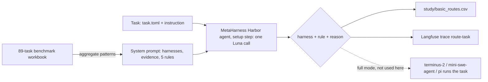

# Presentation guide: the Terminal-Bench harness router (iLab S2 2026, Project 16)

Everything needed to present the project: the problem, every approach we tried and why we moved on, the final
router and its full system prompt, how it runs, the results, the limits, a demo script and likely questions.
All numbers here come from files in this repo; where a number comes from, it says so.

---

## 1. The project in one minute

**Brief (Project 16):** build a meta-harness that routes each Terminal-Bench task to the best agent harness, with a
fallback harness if the first attempt fails.

- **Terminal-Bench** is a benchmark of 89 real terminal tasks: fix a git repo, build a compiler, boot a VM, train a
  model, crack a hash. Each task runs in its own Docker container and is graded by hidden tests.
- An **agent harness** is the program that lets a language model work in a terminal: it shows the model the screen
  or command output, runs what the model asks, and loops. Different harnesses give the model different tools.
- **The question:** if the model stays the same, does choosing the harness per task beat always using the single
  best harness?
- **Harbor** is the framework that runs Terminal-Bench: it starts the container, runs an agent and grades the result.

The three harnesses:

| Harness | How the model works in it | Strengths | Weaknesses |
|---|---|---|---|
| **terminus-2** | Types keystrokes into one persistent tmux terminal | Interactive programs, VM consoles, servers that must stay up, shell state survives | Most expensive; must poll long commands; 10 kB output cap |
| **mini-swe-agent** | Runs one bash command at a time in a fresh shell, 30 s limit per command | Simple, predictable, best overall pass rate | No interactive programs; shell state (cd, exports) is lost between commands |
| **pi** | File tools (read, write, edit, grep, find, ls) plus bash | Cheapest and fastest; can read images | No persistent shell, no keystrokes |

**Fixed throughout:** the executor model is always GPT-5.6-Luna (`openrouter/openai/gpt-5.6-luna`), so any difference
comes from the harness. The router model is also Luna.

---

## 2. What we built in the end (the final deliverable)

A **basic, prompt-only router packaged as a Harbor agent**:

1. Its only knowledge is the **89-task benchmark analysis**, `Qwen_89_Task_Comparison_2026-09-20.xlsx`: one run of
   each harness on all 89 tasks (Qwen3-Coder as the model). Luna's own 45-task runs are deliberately **not** used.
2. That analysis was turned into a **system prompt**: what each harness is, what the benchmark showed (aggregate
   counts only, never per-task answers), and five ordered decision rules.
3. For each task, **one Luna call** with that system prompt plus the task's metadata and instruction returns a
   harness, the rule that decided it and a one-line reason.
4. It runs **as a Harbor agent** (`meta_harness:MetaHarness`), so Harbor treats the router like any other agent.
5. For this deliverable it only **routes**: no harness is installed, no task is run, no tests run. Every decision
   is stored in a **CSV** and in **Langfuse**.

All 89 tasks have been routed: `study/basic_routes.csv` and 89 Langfuse traces.



---

## 3. How we got here: every approach, in order

| When | Approach | What happened | Why we moved on |
|---|---|---|---|
| 18–22 Sep | Benchmarked Luna in several harnesses; first LLM routers (Luna, Gemma 270M) and classifiers on the Qwen 89-task data | Classifiers (four families, TF-IDF on task text) all collapsed to "always guess the majority harness" (31.5%, oracle 40.4%). Gemma's picks followed list order. Luna rated pi 4–5 on almost every task | Task text alone carried little signal |
| 29 Sep | Rewrote the routing prompt; made mini-swe-agent the default; prompt-iteration experiment | Across 21 tasks: always mini-swe-agent 13.0, routers and random 12.5–13.0, oracle 15.9. One prompt variant scored 14.67 once, then averaged 11.9 over 8 runs | Wording changed *which* harness was picked, not whether the right one was found; single runs are noisy |
| 29 Sep – 3 Oct | `typesafe/jev-router` as the router | Withdrawn: it forwards requests to other models (DeepSeek, GPT-6.1-Sol), so its answers were never its own | Not a valid router for the study |
| 3 Oct | **Harness profiles**: Luna read each harness's source code and wrote a factual profile (frozen, hash-checked); Luna or Jev picks from the profiles | LLM router (Luna) 58.0% vs always mini-swe-agent 61.7% under 5-fold cross-validation | Did not beat the fixed baseline |
| 3–5 Oct | **Phase 1**: Luna on 45 tasks × 3 harnesses × 3 repeats (about 450 runs, about $8.4) | Real headroom: perfect picking 75.3% vs 61.7%. But only 50 of 81 cells gave the same result on all three repeats; 6.2 points of "headroom" was luck | Showed the problem is noisy and small |
| 7 Oct | Learned routers with k-fold cross-validation: decision tree on metadata, k-NN on task text, LLM routers | Tree 58.0–61.7%, k-NN 51.9–55.6%, Luna 58.0%, Jev 56.8%; baseline 61.7%. Nothing beat it with a confidence interval excluding zero | Every router lost by diverting away from mini-swe-agent too often |
| 7 Oct | **Success table / lookup cache**: hard-code the best harness for tasks Luna already ran | Reaches the oracle on those tasks by construction, but that is memorisation, not routing; scored honestly by k-fold it was +2.3 points [−2.3, +7.6] | Says nothing about unseen tasks |
| 7 Oct | **Fallback** simulation (retry after a run-time failure) | Retrying after a crash or timeout lifts always-terminus-2 from 51.9% to 61.7%, but retrying the *same* harness gains as much as switching | The gain is crash recovery, not harness choice; we kept a same-harness retry |
| 9 Oct | **Meta-harness as a Harbor agent**, fallback in the final-run pipeline, BYOK billing | Live smoke runs and a 5-task test passed (4/5 solved, $0.025) | Infrastructure ready; full benchmark run deferred |
| 11 Oct | **Basic prompt-only router** from the 89-task workbook only, route-only | All 89 tasks routed, $0.021, CSV + Langfuse | **This is the final version** |

The lesson that shaped the final design: routing gains are small and fragile, the best single harness
(mini-swe-agent) is hard to beat, and the cheapest honest router is one clear prompt with rules that stay on
mini-swe-agent unless the task clearly needs something else.

---

## 4. From the benchmark analysis to the rules

Source: `Qwen_89_Task_Comparison_2026-09-20.xlsx`, sheet "Trial details" (one Qwen3-Coder trial per task and
harness). `python3 router/basic_analysis.py` recomputes every number below from the workbook alone.

| Pattern | Evidence (tasks passed) | Rule it became |
|---|---|---|
| mini-swe-agent is the best single harness | 28/89 vs terminus-2 22, pi 16; highest share of tests passed (0.58) | Default (rule 5) |
| Builds, debugging, git favour mini-swe-agent | Builds 12/30 vs 7 and 4; debugging 2/5 vs 0 and 0; git 3/4 vs 1 and 1 | Rule 5 |
| Only terminus-2 can even start VM/QEMU tasks | mini-swe-agent and pi failed to install in those containers | Rule 1 |
| Server tasks: tie, but terminus-2 never crashed | 8 vs 8 vs 4; crashes 0, 3, 2 | Rule 2 |
| pi never passes data science or model training | Data science 0/8, model training 0/4 | Rule 3 (never pi) |
| pi ties on security at the lowest cost | Security 3 vs 3 vs 2; median cost $0.06 vs $0.14 vs $0.20 | Rule 4 |
| Long, hard tasks are rarely solved by anyone | Hard: 4, 3, 1 of 30; over 30 min: 2, 0, 1 of 18 | Stay on the default |

**The five rules** (first one that applies wins):

1. VM, emulator, or a live interactive program kept open → **terminus-2**
2. Must start a server or daemon and keep it running → **terminus-2**
3. ML training or models, or data science → **terminus-2** for long-running jobs, otherwise **mini-swe-agent**; never pi
4. Self-contained security, crypto, password cracking or maths solved by scripts → **pi**
5. Everything else → **mini-swe-agent**

---

## 5. The system prompt (full text)

File: `router/basic_system_prompt.txt` (SHA-256 prefix `6d30efcfcb2c654c`, recorded on every decision).

```text
You route Terminal-Bench tasks to an agent harness. The same language model (GPT-5.6-Luna) will solve the task inside whichever harness you choose; only the harness differs. Choose the harness most likely to pass the task's hidden tests, and prefer the cheaper one when the evidence does not separate them.

## The three harnesses

terminus-2
- Drives one persistent tmux shell with literal keystrokes (including Ctrl-C, Ctrl-D). Working directory, environment variables, background processes and open interactive programs (REPLs, editors, VM consoles, curses UIs) survive between steps.
- Commands are non-blocking: it waits up to 60 s per command and must poll for anything longer. Output is capped at 10,000 bytes per observation. Summarises its own context when it runs long.
- The most expensive harness: about 1.5x mini-swe-agent and 3x pi per task.

mini-swe-agent
- Bash only. Every command runs in a fresh subprocess with a 30 s timeout that kills it; files persist, shell state (cd, exports, activated venvs) does not. No keystrokes, so no interactive programs. Output over 10,000 characters is cut to head and tail. No context compaction.
- Simple and predictable. Mid-priced.

pi
- Tools: read, write, exact-replacement edit, grep, find, ls, and bash (fresh shell per call, no default timeout). Can read images. Compacts long sessions automatically.
- No persistent shell and no keystrokes; interactive programs only through tmux started by hand.
- The cheapest and fastest harness.

## What the benchmark showed

Source: the 89-task benchmark analysis, one run of each harness on all 89 Terminal-Bench tasks (Qwen3-Coder as the model, 4 harnesses, of which these 3 are ours). Results are counts of tasks passed.

- Overall: mini-swe-agent 28/89, terminus-2 22/89, pi 16/89. mini-swe-agent also had the highest average share of tests passed (0.58, against 0.55 and 0.51). Median cost per task: pi $0.06, mini-swe-agent $0.14, terminus-2 $0.20.
- By difficulty: easy 4 tasks, all three harnesses 3/4. Medium 55: mini-swe-agent 21, terminus-2 16, pi 12. Hard 30: mini-swe-agent 4, terminus-2 3, pi 1.
- By the task's agent time limit: up to 15 min (49 tasks): mini-swe-agent 23, terminus-2 20, pi 14. 15 to 30 min (22): mini-swe-agent 3, terminus-2 2, pi 1. Over 30 min (18): mini-swe-agent 2, terminus-2 0, pi 1. Long, hard tasks are rarely solved by any harness, so the choice there matters little.
- Software engineering (26): mini-swe-agent 10, terminus-2 7, pi 5. Debugging (5): mini-swe-agent 2, the others 0. Tasks that compile or build code (30): mini-swe-agent 12, terminus-2 7, pi 4. Git work (4): mini-swe-agent 3, the others 1.
- Data science (8): terminus-2 2, mini-swe-agent 2, pi 0. Model training (4): terminus-2 2, mini-swe-agent 1, pi 0. Tasks about training or loading ML models (19): terminus-2 3, mini-swe-agent 2, pi 1.
- Security (8): terminus-2 3, pi 3, mini-swe-agent 2. Mathematics (4): mini-swe-agent 1, pi 1, terminus-2 0. Data processing (4): mini-swe-agent 2, pi 2, terminus-2 1. System administration (9): terminus-2 4, mini-swe-agent 4, pi 3.
- Tasks that run a server, daemon or network service (14): terminus-2 8, mini-swe-agent 8, pi 4; mini-swe-agent crashed on 3 of them and pi on 2, terminus-2 on none.
- Tasks that boot or drive a virtual machine (QEMU): mini-swe-agent and pi failed to even install in those containers (setup error); terminus-2 was the only harness that could start.
- Tasks built around images, video or PDFs (13): almost nothing passed (mini-swe-agent 1, the others 0).
- Crashes: terminus-2 crashed or errored on 2 of 89 tasks, mini-swe-agent on 5, pi on 5.

## How to decide

Work through these in order and stop at the first rule that applies.

1. The task boots, logs into or controls a virtual machine or emulator (QEMU, a VM console), or must keep an interactive program open and type into it across many steps (a REPL session, a curses or full-screen UI, an interactive installer): choose terminus-2.
2. The task must start a long-running server, daemon or service and keep it running while it is configured or tested: choose terminus-2.
3. The task trains, fine-tunes or runs ML models, or processes datasets with ML tooling (PyTorch, Hugging Face, tokenisers), or is data science: choose terminus-2 if the work involves long-running jobs, otherwise mini-swe-agent. Never pi here.
4. A self-contained security, cryptography, password or hash-cracking, or mathematics task that is solved by writing and running scripts, with no services and no ML: choose pi (as good as the others on these tasks and much cheaper).
5. Everything else, including code changes, builds and compilation, debugging, git, system configuration done with ordinary commands, data processing, and hard or long tasks where nothing clearly applies: choose mini-swe-agent.

Judge by what the task actually requires, not by words that merely appear in it. A task that mentions a server but only edits its configuration file is not rule 2.

Reply with only JSON:
{"rule": <1-5>, "reason": "<one or two sentences naming the task features that decided it>", "harness": "<terminus-2|mini-swe-agent|pi>"}
```

**What the router sees for each task** (the user message), for example:

```text
Task: qemu-startup
Category: system-administration
Difficulty: medium
Tags: sys-admin
Agent time limit: 15 min

Instruction:
"""
Start the /app/alpine.iso image in qemu in such a way that I can connect to it via `telnet 127.0.0.1 6665`. ...
"""
```

**Design choices worth mentioning:**

- **Aggregates only, no per-task answers.** The prompt never says "task X goes to harness Y", so the router has to
  reason about the task rather than look it up.
- **Ordered rules with a default.** Earlier routers lost by moving away from mini-swe-agent too often, so every rule
  is a narrow exception and everything else falls through to the best single harness.
- **Mechanism plus evidence.** Each harness is described by how it works (from its source code), and each rule is
  backed by a count from the benchmark, so a reason can always be traced to a fact.
- **Explainable output.** Every decision names its rule and gives a reason, which goes into the CSV and Langfuse.
- **Versioned.** The prompt's hash is stored with every decision, so a result can always be tied to the exact prompt.

---

## 6. How it runs (architecture)

| Piece | File | Role |
|---|---|---|
| Harbor agent | `router/meta_harness.py` (`MetaHarness`) | Routes in Harbor's agent `setup()` step; with `route_only=true` it stops there, otherwise it hands the task to the chosen harness |
| Routing step | `router/meta_route.py` | Picks the router: `basic` (this one), or the older `luna` / `jev` table routers |
| Basic router | `router/basic_router.py` | Builds the user message from `task.toml` + instruction, makes one Luna call, parses `{rule, reason, harness}` |
| System prompt | `router/basic_system_prompt.txt` | The rules (section 5) |
| Analysis | `router/basic_analysis.py` | Recomputes every number in the prompt from the workbook |
| Batch runner | `study/route_basic.sh` | Runs Harbor per task, writes the CSV row, sends the Langfuse trace |
| Langfuse export | `study/langfuse_export.py --route-only` | One `route-task` trace per decision |

One task, step by step:

```bash
PYTHONPATH=router harbor run -t terminal-bench/<task> --model openrouter/openai/gpt-5.6-luna \
  --agent meta_harness:MetaHarness --ak router=basic --ak route_only=true --install-only
```

1. Harbor starts the task's Docker container.
2. Harbor calls the agent's `setup()`. The agent reads the task's metadata and instruction and makes one Luna call
   with the system prompt.
3. The decision (harness, rule, reason, tokens, cost, timing, prompt hash) is saved as `agent/route.json` in the job.
4. `--install-only` plus `route_only=true`: nothing is installed or run, and no tests run. Harbor exits.
5. The script appends a row to `study/basic_routes.csv` and sends a Langfuse trace.

**Langfuse:** each decision is one `route-task` generation. Input: the full system prompt and the task message.
Output: harness, rule and reason. Recorded: model, tokens, cost, latency, prompt hash. Tags: `router:basic`,
`harness:<name>`, `rule:<n>`, `mode:route-only`; the session is the task name. Secrets are scrubbed before sending.

**Full mode (built, tested, not used for this deliverable):** without `route_only`, the same agent installs the
chosen harness and runs the task, and Harbor grades it. `study/run_final.sh` adds a same-harness retry when a
run crashes or times out (the brief's fallback). Smoke runs and a 5-task test passed this way.

---

## 7. Results

**All 89 tasks routed** (11 Oct, about 50 minutes, $0.021 total, one Luna call per task, median 2.9 s and about
1,600 input tokens per call):

| Harness | Tasks |
|---|---|
| mini-swe-agent | 58 |
| terminus-2 | 18 |
| pi | 13 |

| Rule | Times used |
|---|---|
| 1 (VM / interactive) | 5 |
| 2 (server) | 7 |
| 3 (ML / data) | 15 |
| 4 (security / maths) | 11 |
| 5 (default) | 51 |

**Example decisions** (from `study/basic_routes.csv`):

| Task | Harness | Rule | Router's reason |
|---|---|---|---|
| qemu-startup | terminus-2 | 1 | Boots an Alpine ISO in QEMU and keeps an interactive VM console running for telnet access |
| pypi-server | terminus-2 | 2 | Starts and keeps a local PyPI server running on port 8080 while configuring and testing package installation |
| caffe-cifar-10 | terminus-2 | 3 | Installs Caffe and runs a CNN training job on CIFAR-10, a long-running ML job |
| crack-7z-hash | pi | 4 | Self-contained security task: crack a password-protected 7z archive, no service or ML |
| fix-git | mini-swe-agent | 5 | Straightforward git task: find and merge changes, nothing interactive |
| build-pmars | mini-swe-agent | 5 | Self-contained build from Debian source, no service, VM or ML |

**How good are the picks?** We did not run the tasks, so the only check is against the same workbook the rules
came from. That flatters the router, so it is a sanity check, not an evaluation:

| Strategy | Tasks passed in the workbook |
|---|---|
| Basic router's picks | 26 / 89 |
| Always mini-swe-agent | 28 / 89 |
| Always terminus-2 | 22 / 89 |
| Always pi | 16 / 89 |
| Oracle (best harness per task) | 35 / 89 |

By rule: the server, ML and security rules land exactly level with always-mini-swe-agent on their tasks; the VM
rule and two image tasks lose one task each. This matches everything earlier in the project: the best single
harness is very hard to beat, and the router should only divert on strong evidence.

---

## 8. Honest limitations (say these before someone asks)

- **No task was run with the basic router**, so there is no real pass rate for it, only the in-sample check above.
- **The evidence is thin.** One trial per task and harness, from a different model (Qwen3-Coder). The workbook
  itself warns these are single observations, "not a proven speciality". Phase 1 showed only 50 of 81 cells repeat
  the same result three times.
- **Rule 1 is weaker than it sounds.** terminus-2 is chosen for VM tasks only because the other two could not
  install there; it still passed 0 of 5, and 0 of 6 on interactive-terminal tasks.
- **Images pull towards pi.** The prompt says pi can read images, so Luna sent two image tasks (chess-best-move,
  code-from-image) to pi while citing the default rule, although image tasks almost never pass and mini-swe-agent
  passed code-from-image.
- **Not fully repeatable.** Routing all 89 tasks twice with near-identical prompts changed 6 picks, all borderline,
  even at temperature 0.
- **Small categories.** Rules 2–4 rest on 4–14 tasks each.

**Next improvements (already identified):** state in rule 1 why terminus-2 is chosen; send image tasks to
mini-swe-agent; mark the evidence as single-trial; narrow rule 3 to ML training; then actually run the routed
harnesses to get a real pass rate.

---

## 9. Demo script (5 minutes)

From the repo root, with Docker running and `.env` filled in:

```bash
# 1. Show the prompt and that its numbers come from the workbook (free, no network)
less router/basic_system_prompt.txt
python3 router/basic_analysis.py

# 2. Route one task live as a Harbor agent (about 20 s, about $0.0002)
study/route_basic.sh fix-git            # ends with: fix-git -> mini-swe-agent rule 5 ...

# 3. Show the stored decision
tail -1 study/basic_routes.csv
cat jobs/route-basic-fix-git-*/fix-git__*/agent/route.json | head -40

# 4. Open the Langfuse link from the CSV row: the prompt in, the decision out, tokens and cost

# Without Harbor or Docker (same decision, one Luna call):
python3 router/basic_router.py qemu-startup
```

Good tasks to show, one per rule: `qemu-startup` (1), `pypi-server` (2), `caffe-cifar-10` (3), `crack-7z-hash` (4),
`fix-git` (5).

---

## 10. Likely questions

**Why not just always use mini-swe-agent?** Honestly, on current evidence that is the safest single choice, and the
router keeps it for 58 of 89 tasks. The router's job is to catch the tasks mini-swe-agent cannot handle at all
(VMs, long-lived servers) and to save money where a cheaper harness is just as good (pi on security scripts).

**Why use another model's results (Qwen3-Coder)?** It is the only benchmark that covers all 89 tasks with every
harness. Earlier we found that Qwen's passing harness is Luna's best harness 76% of the time against 33% by chance,
so the patterns transfer reasonably, but not perfectly.

**Why not train a classifier?** We did: four classifier families on task text, a decision tree on metadata and
k-NN all failed to beat always-mini-swe-agent under cross-validation. With 89 tasks there is too little data to
learn from; a short, explainable rule list does as well and can be checked by a human.

**Isn't the in-sample check cheating?** Yes, which is why we call it a sanity check. Even on its own data the router
does not beat the best single harness, which is itself a finding.

**How much does routing cost?** About $0.0002 and 3 seconds per task with Luna. A full task run costs about
$0.004–0.02, so routing adds roughly 1–5%.

**What about the fallback in the brief?** Built into the full pipeline: if a run crashes or times out, the same
harness runs once more. Our simulation showed that retrying the same harness recovers as many tasks as switching,
because most failures are infrastructure crashes. It never uses the hidden tests to decide.

**Why is the router a Harbor agent?** The brief asks for a meta-harness. As a Harbor agent, `harbor run --agent
meta_harness:MetaHarness` treats the router like any other harness: Harbor starts the task, the meta-harness picks
the real harness and hands over, and results, logs and costs are recorded the standard way.

**Can it be gamed by keywords?** The prompt tells the router to judge what the task requires, not words that appear
in it, and every decision states its reason, so mistakes are visible in the CSV and Langfuse.

---

## 11. Where everything is

| What | Where |
|---|---|
| Routing decisions, all 89 tasks | `study/basic_routes.csv` (earlier prompt version: `study/basic_routes_prompt-e5985eb3.csv`) |
| System prompt | `router/basic_system_prompt.txt` |
| Evidence behind the prompt | `Qwen_89_Task_Comparison_2026-09-20.xlsx`, recomputed by `router/basic_analysis.py` |
| Router code | `router/basic_router.py`, `router/meta_harness.py`, `router/meta_route.py` |
| Batch script | `study/route_basic.sh` |
| Per-task Harbor jobs | `jobs/route-basic-<task>-<time>/` (each has `agent/route.json`) |
| Langfuse | Project traces named `route-task`, tag `router:basic` |
| Full history of every experiment | `PROJECT_LOG.md` (newest first); research design in `PROBLEM_DEFINITION.md` |
| Setup and commands | `README.md`; how a full run works end to end: `HOW_IT_WORKS.md` |
